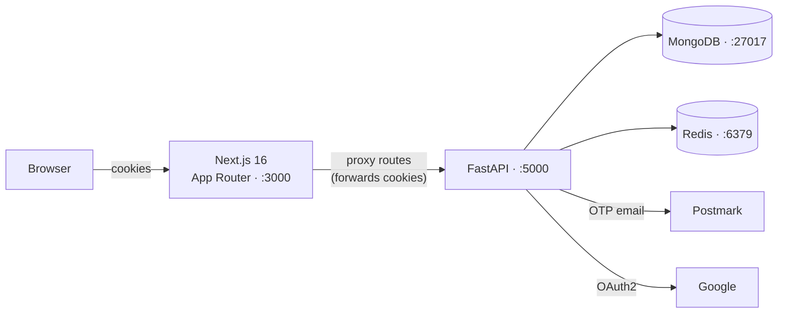

<div align="center">

# KIVO

**Organise work into spaces, projects and tasks, with a glassmorphic UI and secure passwordless auth.**

Team collaboration and an infinite brainstorming canvas are on the roadmap.


[Features](#-features) · [Architecture](#-architecture) · [Getting started](#-getting-started) · [API](#-api-reference) · [Roadmap](#-roadmap)

</div>

---

<!-- Add a hero screenshot or GIF here:
<p align="center"></p>
-->

## Overview

KIVO is a task management platform built as a monorepo: a **Next.js 16** frontend and a **FastAPI** backend backed by **MongoDB** and **Redis**.

Work is organised in a clear hierarchy:

```
Space  →  Project / Folder  →  Tasks · Notes & docs · Resources
```

Each space opens as a bento-style overview, each project has its own task views (list, board, calendar), and notes are written in a rich text editor. Sessions use rotating httpOnly-cookie JWTs, and sign-in is passwordless (email OTP or Google).

---

## ✨ Features

### Workspace
- **Spaces** — top-level containers with a collapsible sidebar group and a "New space" dialog. Duplicate names within an account are rejected.
- **Bento overview** — each space renders a six-column grid: Recents, Upcoming deadlines, Docs & notes, Folders & projects, Workload by status, Attachments.
- **Projects & folders** — nested under spaces and in the sidebar, each with its own page.
- **Resources** — attach files and links to a project.

### Tasks
- **Three views** — **List**, **Board** (columns by status) and **Calendar** (by due date).
- **Rich task model** — title, description, assignee, priority, status, due date and a completion checklist.
- **Derived progress** — progress is the share of ticked checklist items, so it always matches the work actually listed rather than a manually set percentage.
- **Custom priorities and statuses** — start with built-ins (`low` / `medium` / `high` / `urgent` and `todo` / `in_progress` / `review` / `done`), then add your own with a name and colour. Custom options are stored per account; built-ins can't be deleted.

### Notes & docs
- **TipTap editor** — bold, italic, underline, strikethrough, H1–H3, bullet and numbered lists, blockquote, code blocks, undo/redo, text colour and custom highlight colour.
- **Per-note background** — preset swatches plus an arbitrary hex picker.
- **Bulk select and delete.**
- **Server-side sanitisation** — note HTML is cleaned with `nh3` before storage, and inline styles are filtered down to `color` and `background-color`, so a note can't inject scripts or arbitrary CSS.

### Authentication & sessions
- **Email OTP** — 6-digit codes sent via **Postmark**, stored in Redis with a 10-minute TTL.
- **Google OAuth2** — standard consent flow with user upsert.
- **httpOnly cookie sessions** — short-lived access token plus rotating refresh token.
- **Silent refresh** — when the access token has expired but the refresh token is valid, `src/proxy.ts` rotates both before the page renders, so users aren't bounced to the login screen.
- **Route guards** enforced at the edge of the Next.js app (see [Routing](#routing)).

### UI
- **Glassmorphism** built with two Tailwind v4 utilities (`glass`, `glass-subtle`) using `backdrop-filter` blur and saturation, with no WebGL or shaders.
- **Theme-aware** surfaces mixed from the `--card` token.
- **shadcn/ui** components, including a collapsible icon sidebar.

---

## 🏗 Architecture



The Next.js app never talks to the database directly. Server components fetch data from FastAPI, and `src/app/api/*` routes proxy browser requests to it while forwarding the session cookies.

### Services

| Service | Port | Notes |
|---|---|---|
| Next.js | 3000 | Frontend |
| FastAPI | 5000 | API and auth |
| MongoDB | 27017 | Primary datastore |
| Redis | 6379 | OTP storage, append-only persistence |

> ⚠️ The default MongoDB credentials in `docker-compose.yml` are for **local development only**. Change them for anything deployed.

### Routing

`src/proxy.ts` (Next 16's replacement for middleware) enforces these rules before a route renders:

| Route | Not signed in | Signed in |
|---|---|---|
| `/` | → `/auth` | → `/dashboard` |
| `/auth` | shows auth form | → `/dashboard` |
| `/dashboard` | → `/auth` | shows dashboard |
| `/auth/callback` | → `/auth` | → `/dashboard` |

### Sessions

| Cookie | Type | Lifetime | Purpose |
|---|---|---|---|
| `access_token` | httpOnly | 15 min | JWT, `HS256` |
| `refresh_token` | httpOnly | 7 days | JWT, rotated on every refresh |

### Tech stack

| Layer | Technology |
|---|---|
| Frontend | Next.js 16 (App Router, Turbopack), Tailwind CSS v4, shadcn/ui, Hugeicons, TipTap |
| Backend | FastAPI, Uvicorn, Motor (async MongoDB), Redis |
| Auth & security | `python-jose` (JWT), Postmark via `httpx`, `nh3` (HTML sanitising) |
| Observability | Sentry (`@sentry/nextjs`) |
| Testing | Vitest + Testing Library (frontend), script-based tests (backend) |
| Infra | Docker Compose |

---

## 🚀 Getting started

### Prerequisites

- Docker and Docker Compose
- Node.js (a version supported by Next.js 16) and npm

### Setup

```bash
# 1. Clone
git clone https://github.com/D3vi7x7/KIVO.git
cd KIVO

# 2. Configure secrets (Postmark, JWT, Google OAuth)
cp .env.example .env

# 3. Start infrastructure and backend
docker compose up -d --build mongodb redis fastapi

# 4. Start the frontend
cd nextjs-app
cp .env.example .env.local
npm install
npm run dev
```

Open **http://localhost:3000/auth**.

### Configuration

| Variable | Purpose |
|---|---|
| `POSTMARK_API_KEY` | Sends OTP emails. **Optional in dev**: without it, codes are printed to the backend logs as `[DEV OTP] <email> (<flow>): <code>` |
| `GOOGLE_CLIENT_ID` / `GOOGLE_CLIENT_SECRET` | Google sign-in. Register `http://localhost:5000/auth/google/callback` as an authorised redirect URI |
| `SECURE_COOKIES` | Set to `true` behind HTTPS in production |

JWT secrets and the rest of the configuration are listed in `.env.example`.

### Scripts

```bash
cd nextjs-app
npm run dev      # dev server
npm run build    # production build
npm run lint     # ESLint
npm test         # Vitest component tests
```

---

## 📡 API reference

Interactive docs are served by FastAPI at `http://localhost:5000/docs`.

<details>
<summary><b>Auth</b></summary>

| Route | Purpose |
|---|---|
| `POST /auth/signup/request-otp` | Send a signup code (rejects existing accounts) |
| `POST /auth/signup/verify-otp` | Verify the code, create the account and session |
| `POST /auth/login/request-otp` | Send a login code (rejects unknown accounts) |
| `POST /auth/verify-otp` | Verify the code and create the session |
| `GET /auth/google` | Returns the Google consent URL |
| `GET /auth/google/callback` | Exchanges the code, upserts the user, sets cookies |
| `POST /auth/refresh` | Rotates both tokens from the refresh cookie |
| `POST /auth/logout` | Clears both cookies |
| `GET /auth/me` | Returns the current user |

</details>

<details>
<summary><b>Spaces</b></summary>

Spaces are scoped to the user that created them.

| Route | Purpose |
|---|---|
| `GET /spaces` | List spaces owned by the caller |
| `POST /spaces` | Create a space (name, optional description) |
| `GET /spaces/{id}` | Fetch one space |
| `DELETE /spaces/{id}` | Delete a space and its items |

</details>

<details>
<summary><b>Projects, tasks & resources</b></summary>

| Route | Purpose |
|---|---|
| `GET /projects` | Every project the caller owns |
| `GET /spaces/{id}/projects` | Projects in a space |
| `POST /spaces/{id}/projects` | Create a project or folder |
| `GET/PATCH/DELETE /projects/{id}` | Read, rename, delete |
| `GET/POST /projects/{id}/tasks` | List and create tasks |
| `PATCH/DELETE /tasks/{id}` | Update and delete a task |
| `GET/POST /projects/{id}/resources` | List and add resources |
| `DELETE /resources/{id}` | Remove a resource |

</details>

<details>
<summary><b>Notes</b></summary>

A note stores `title`, `content` (sanitised HTML), `background` and `color`, and can belong to a space or a project (`project_id`).

| Route | Purpose |
|---|---|
| `GET /spaces/{id}/notes` | List notes in a space |
| `POST /spaces/{id}/notes` | Create a note |
| `PATCH /notes/{id}` | Update a note |
| `DELETE /notes/{id}` | Delete a note |

</details>

<details>
<summary><b>Task options (custom priorities & statuses)</b></summary>

| Route | Purpose |
|---|---|
| `GET /task-options` | List all options (built-in + custom) |
| `POST /task-options` | Create a custom priority or status |
| `DELETE /task-options/{id}` | Remove a custom option |

</details>

---

## 📁 Project structure

```
KIVO/
├── docker-compose.yml
├── .env.example                  # Docker Compose secrets (copy to .env)
├── docker/mongo-init.js
├── mcpServer/
├── nextjs-app/
│   ├── sentry.{client,server,edge}.config.ts
│   └── src/
│       ├── proxy.ts              # Session refresh + route guards
│       ├── lib/session.ts        # Server-side session helper
│       ├── components/
│       │   ├── app-sidebar.tsx         # Dashboard sidebar
│       │   ├── spaces-nav.tsx          # Collapsible spaces + nested projects
│       │   ├── space-bento.tsx         # Space bento grid
│       │   ├── docs-notes-section.tsx  # Docs & notes + bulk select
│       │   ├── note-editor.tsx         # TipTap editor dialog
│       │   ├── projects-section.tsx    # Folders & projects
│       │   ├── resources-section.tsx   # Files and links
│       │   ├── tasks-panel.tsx         # List / Board / Calendar
│       │   ├── task-form-dialog.tsx    # Task create + edit
│       │   └── ui/                     # shadcn/ui components
│       └── app/
│           ├── auth/                   # Login / signup + Google callback
│           ├── dashboard/              # Sidebar layout, spaces, projects
│           └── api/                    # Proxy routes → FastAPI
└── services/fastapi-app/
    └── app/
        ├── main.py               # App wiring + health + cache
        └── auth.py               # OTP, Google OAuth, JWT, cookies
```

---

## 🧪 Testing

```bash
# Frontend (Vitest + Testing Library, jsdom)
cd nextjs-app
npm test

# Backend
cd services/fastapi-app
python test_google_callback.py   # mocks Google token + userinfo endpoints
python test_routes.py
```

---

## 🔒 Security notes

- Sessions live in **httpOnly cookies**, so tokens aren't readable from JavaScript.
- Refresh tokens are **rotated on every use**.
- Note HTML is **sanitised server-side** (`nh3`) and styles are allow-listed.
- Spaces are **owner-scoped**: a space is only returned to the user who created it.
- OTP codes **expire after 10 minutes** (Redis TTL).

---

## 🗺 Roadmap

KIVO is under active development. Current status, honestly:

**Done**
- [x] Email OTP and Google authentication with rotating sessions
- [x] Spaces, projects and folders
- [x] Tasks with List / Board / Calendar views, checklist-derived progress, custom priorities and statuses
- [x] Rich text notes with server-side sanitisation
- [x] Resources (files and links)
- [x] Wire real data into the bento sections (Recents, Upcoming deadlines, Workload by status, Attachments currently render empty states)
- [x] Shared spaces and team collaboration (spaces are currently single-owner)
- [x] Boards and workspace switcher (present in the sidebar, not yet functional)
- [x] Infinite collaborative canvas for brainstorming
- [x] Real-time updates

**In progress / planned**
- [ ] Realtime moodboard and collaborative canvas like canva
- [ ] Make it available locally as well as on cloud.

---

## 🤝 Contributing

Issues and pull requests are welcome.

1. Fork the repo
2. Create a branch: `git checkout -b feat/your-feature`
3. Commit your changes and push
4. Open a pull request

Please run `npm run lint` and `npm test` before submitting.

---

## 👤 Author

**Devi Prasad Sundaray** ([@D3vi7x7](https://github.com/D3vi7x7))

<!-- Add a LICENSE file and reference it here, e.g. "Released under the MIT License." -->
